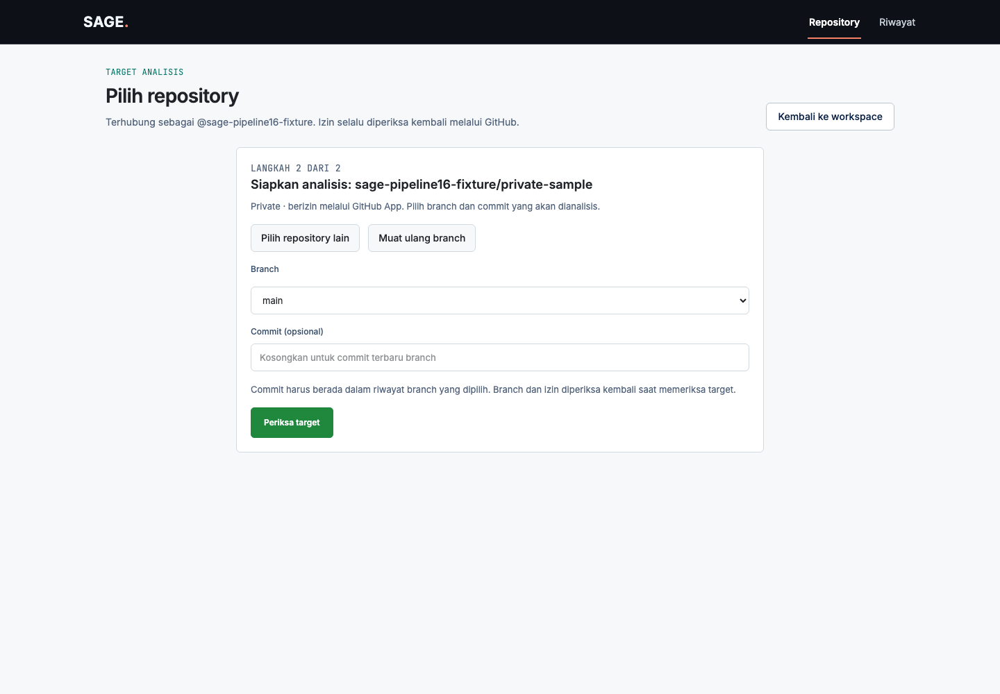
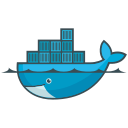

<p align="center">
  
</p>

<p align="center"><strong>Source-code Architecture Graph Extraction</strong><br />Pahami komponen, dependency, dan alur aplikasi melalui dokumentasi berbasis evidence source code.</p>

<p align="center"><a href="https://sage.caiis.ai.id/">Buka SAGE</a> · <a href="docs/guides/USAGE.md">Panduan penggunaan</a> · <a href="docs/README.md">Dokumentasi</a> · <a href="CONTRIBUTING.md">Kontribusi</a></p>

## Fitur dan dukungan

| Fitur | Yang bisa dilakukan |
| --- | --- |
| Akses GitHub | Login dengan GitHub App; pilih repository public sendiri, public pihak lain, atau private yang diizinkan |
| Analisis repository | Pilih branch/commit, jalankan pipeline berurutan, pantau progres dan elapsed time, lalu retry jika gagal |
| Code Knowledge | Telusuri komponen dan dependency kode, filter node, fokus tetangga, serta periksa evidence file/baris |
| Dokumentasi hasil | Baca Interface Catalog, Software Engineering Diagram, dan UML Class Diagram dari snapshot yang sama |
| Koreksi dan ekspor | Koreksi label/kelompok model semantik; ekspor Markdown lengkap atau PDF ringkas dengan diagram vektor A4 |
| History | Cari dan buka kembali hasil milik akun sendiri, lalu hapus analisis beserta artefaknya setelah konfirmasi |

**Batas analyzer:** analisis statis PHP dan JavaScript/TypeScript tidak menjalankan kode target dan tidak memakai layanan AI eksternal. Pengenalan user flow mendukung pola **Next.js App Router dan Laravel** yang teruji; kandidat guard Node HTTP terbatas tidak berarti semua framework didukung. Import atau kedekatan folder tidak membuktikan urutan aktivitas.

**Code Knowledge** menunjukkan struktur/dependency; **Software Engineering Diagram** menunjukkan aktor, fitur, dan alur yang dikenali; **UML** menunjukkan class dan relasi yang ditemukan, bukan daftar seluruh file. Source dinamis dapat tetap `Unresolved`; confidence semantik `Proven`/`Indicated` adalah kategori terpisah. Hasil lama mungkin perlu analisis ulang. Markdown memiliki batas ukuran 32 MiB; PDF membagi alur besar menjadi beberapa halaman agar tetap terbaca. Lihat [kontrak analyzer](docs/reference/ANALYSIS_SPEC.md) dan [aturan keluaran](docs/reference/DOCUMENT_PRESENTATION.md).

## Tampilan aplikasi

Screenshot berasal dari aplikasi aktual dengan data fixture aman. Nama repository contoh dan commit sintetis bukan hasil analisis repository pengguna; cakupan pengambilannya tercatat pada [catatan screenshot](docs/assets/screenshots/README.md).

### Pemilihan repository



### Code Knowledge


### Dokumentasi hasil


## Workflow

Klik node untuk membuka panduan terkait. GitHub menyediakan kontrol diagram; pada layar kecil, buka diagram untuk memperbesar.

```mermaid
flowchart LR
  A["Login GitHub"] --> B["Pilih repo dan commit"] --> C["Analisis"] --> D["Graph dan dokumen"] --> E["Ekspor / history"]
  click A "https://github.com/AgilePemdigi-2026/sage/blob/main/docs/guides/GITHUB_APP_SETUP.md" "Setup GitHub App"
  click B "https://github.com/AgilePemdigi-2026/sage/blob/main/docs/guides/USAGE.md#pilih-target" "Pilih target"
  click C "https://github.com/AgilePemdigi-2026/sage/blob/main/docs/guides/USAGE.md#jalankan-analisis" "Progres dan error"
  click D "https://github.com/AgilePemdigi-2026/sage/blob/main/docs/guides/USAGE.md#baca-hasil" "Baca hasil"
  click E "https://github.com/AgilePemdigi-2026/sage/blob/main/docs/guides/USAGE.md#ekspor-dan-history" "Ekspor dan history"
```



## Tech stack

<p align="center">
  <a href="https://nextjs.org/"></a>
  <a href="https://react.dev/"></a>
  <a href="https://www.typescriptlang.org/"></a>
  <a href="https://tailwindcss.com/"></a>
  <a href="https://nodejs.org/"></a>
  <a href="https://www.php.net/"></a>
  <a href="https://www.postgresql.org/"></a>
  <a href="https://www.prisma.io/"></a>
  <a href="https://www.docker.com/"></a>
  <a href="https://playwright.dev/"></a>
</p>

<p align="center">Next.js · React · TypeScript · Tailwind CSS · Node.js<br />PHP · PostgreSQL · Prisma · Docker · Playwright</p>

Web/API memakai Next.js; worker Node.js/PHP menangani analyzer dan ekspor; PostgreSQL menyimpan metadata serta hasil canonical. Snapshot dan file ekspor tersimpan pada volume privat. Rincian ada di [arsitektur](docs/reference/ARCHITECTURE.md) dan [model data](docs/reference/DATA_MODEL.md). Logo mengikuti [lisensi aset](docs/assets/tech/README.md).

## Quick start Docker

Siapkan **Node.js 24** dan Docker dengan Compose yang aktif. Pengguna macOS dapat mengikuti [setup Colima](docs/guides/LOCAL_SETUP.md).

```sh
git clone https://github.com/AgilePemdigi-2026/sage.git
cd sage
node scripts/setup-local.mjs
docker compose config --quiet
docker compose build
docker compose up -d --wait --wait-timeout 180
```

Buka [localhost:3000](http://localhost:3000). `web`, `worker`, dan `db` harus healthy; `migrate` selesai dengan exit 0. **Login memerlukan konfigurasi GitHub App sendiri** sesuai [panduan GitHub App](docs/guides/GITHUB_APP_SETUP.md). Jangan commit `.env`, token, atau private key.

Untuk menghentikan aplikasi tanpa menghapus data, jalankan `docker compose stop`. Untuk menyalakan container yang sudah dibuat, jalankan `docker compose start`; gunakan `up` di atas jika container belum ada. Perubahan source memerlukan build dan `up` kembali. Jangan memakai `down -v` bila ingin mempertahankan data. Panduan lengkap tersedia pada [setup lokal](docs/guides/LOCAL_SETUP.md).

## Dokumentasi

| Kebutuhan | Panduan |
| --- | --- |
| Mulai memakai aplikasi | [Penggunaan](docs/guides/USAGE.md) · [Troubleshooting](docs/guides/TROUBLESHOOTING.md) |
| Menjalankan dan menguji | [Setup lokal](docs/guides/LOCAL_SETUP.md) · [Testing](docs/guides/TESTING.md) |
| Memahami hasil analisis | [Analyzer](docs/reference/ANALYSIS_SPEC.md) · [Semantik](docs/reference/SEMANTIC_ANALYSIS.md) · [Format keluaran](docs/reference/DOCUMENT_PRESENTATION.md) |
| Mengelola layanan | [Deployment, resource, backup, dan pemulihan](docs/operations/COOLIFY.md) |
| Meninjau requirement dan bukti | [Planning](docs/planning/README.md) · [Arsip pemeriksaan](docs/archive/README.md) · [Evidence](docs/evidence/) |

[Buka seluruh dokumentasi](docs/README.md).
