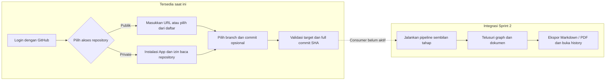

<p align="center">
  
</p>

<p align="center"><strong>Source-code Architecture Graph Extraction</strong><br />Evidence-Grounded Software Architecture Documentation</p>

<p align="center">Pahami arsitektur repository PHP dan JavaScript/TypeScript melalui graph dan dokumentasi yang dapat ditelusuri ke source code.</p>

<p align="center">
  <a href="https://nextjs.org/"></a>
  <a href="https://react.dev/"></a>
  <a href="https://www.typescriptlang.org/"></a>
  <a href="https://tailwindcss.com/"></a>
  <a href="https://nodejs.org/"></a>
  <a href="https://www.php.net/"></a>
  <a href="https://www.postgresql.org/"></a>
  <a href="https://www.prisma.io/"></a>
  <a href="https://www.docker.com/"></a>
  <a href="https://playwright.dev/"></a>
</p>

<p align="center">Next.js · React · TypeScript · Tailwind CSS · Node.js<br />PHP · PostgreSQL · Prisma · Docker · Playwright</p>

<p align="center">
  <a href="docs/LOCAL_SETUP.md">Panduan lokal</a> ·
  <a href="docs/PRODUCT_BACKLOG.md">Backlog</a> ·
  <a href="docs/SPRINT_PLAN.md">Sprint plan</a> ·
  <a href="CONTRIBUTING.md">Kontribusi</a>
</p>

**Dalam pengembangan — per 20 Oktober 2026.** Login dan akses repository sudah tersedia; pipeline analisis penuh serta ekspor produk masih dalam pengembangan.

<details>
<summary>Rincian implementasi dan batas pratinjau</summary>

Login GitHub App, daftar repository public/instalasi, pemilihan branch dan full SHA, `POST /api/analyses` yang mengantre secara idempotent, serta snapshot immutable dan source handlers tersambung ke provider nyata. Worker dapat menjalankan komponen queue dan runner tahap, tetapi consumer analisis penuh masih nonaktif (`workerQueueEnabled=false`); submission belum menghasilkan analisis sembilan tahap.

Landing, login, workspace, dan halaman repository memakai backend autentikasi/repository nyata. Halaman `/preview/progress`, `/preview/history`, `/preview/graph`, dan `/preview/document` adalah pratinjau fixture dari satu contoh source-backed tervalidasi berisi 10 node dan 9 edge, termasuk `ReportService`; halaman tersebut bukan hasil analisis repository pengguna. `/ui-preview` dan `/graph-preview` tetap tersedia sebagai fixture kompatibilitas. Hanya pratinjau Markdown yang dapat diunduh dan ditandai sebagai fixture; ekspor PDF produk belum tersedia. History produk, graph berbasis analysis, dokumen produk, ekspor, dan penghapusan masih mengikuti issue terbuka. Bukti dan batas verifikasi UI dicatat di [UI-02/UI-03 checks](docs/UI-02_CHECKS.md).

</details>

## Kemampuan yang ditargetkan

| Kemampuan | Hasil yang ingin dicapai |
| --- | --- |
| Akses GitHub | Login, repository publik milik pihak lain, dan repository private yang telah diotorisasi |
| Analisis source code | Adapter PHP dan JS/TS dengan model kode serta kontrak evidence yang sama |
| Code Knowledge Graph | Telusuri module, class, interface, function, dan hubungan antarkode |
| Bukti yang dapat diperiksa | Temuan terhubung ke file, baris, dan snapshot commit yang dianalisis |
| Dokumentasi arsitektur | Interface Catalog, Software Engineering Diagram, UML Class Diagram, serta Architecture Definition Document |
| Ekspor dan riwayat | Simpan Markdown/PDF, buka kembali analisis, dan hapus data milik pengguna |

Seluruh kemampuan di atas masuk target MVP lokal. Status implementasi serta acceptance criteria mengikuti [backlog](docs/PRODUCT_BACKLOG.md) dan [test plan](docs/TEST_PLAN.md).

## Alur penggunaan

[Buka workflow interaktif — zoom dan geser diagram](https://mermaid.live/view#pako:eJxVkk1v2zAMhv8KoXPSATvmUCDNZ4cUCJptl3oH2pJjwjIl6KNFl-S_j7aTYL0YkMj3eV-RPqnKaaNmqrbuo2owJNi9FgwQc3kM6BuocgiG01uhfpoQjSaEiJiAmAr1p28FmEt1547EoA0fkWFDaZtLqcN0-ghPp0LtyVID2EYTIRjvIiUXPgt1GQlPfeN5n0tL7RkWwnvBmNtWWL9ed4AJM_gBoTGQfOqE4e5_VQd6x2TOsBT5M8eEFiPB3HvpZ6C_kq_ECr_4XwmLIejq7Ra0DMhVM-gq13WUwPlIjtHeJctRMh5Ww2Et-t9oSfe-EvBo0oCos7U3zmE7vyIM6y-T9haZjR7CJyN3Ajn4QJzg-911I-Uf8jDuR-PJG0tsIJquJLkU0wb9be7bYWk2xywjGz36NNq1uTN8R26H5mdpXrXRuwAvGFrtPhi-wX65HjRlbhEaiv8N7Rp_DdMHKNTCcRRqgFIMO1l0orpQ8CDkTcFqoqTWIWk1O6nUmK7_57SpMdukLhOFObnDJ1dqlkI2E5W9llUuCSV2N15e_gF6peKN). Tampilan ini membuka Mermaid Live; diagram di bawah tetap tersedia langsung di README.

Bagian “Tersedia saat ini” sudah tersedia pada UI. Bagian Sprint 2 menunjukkan alur yang ditargetkan setelah consumer pipeline dan integrasi hasil selesai; halaman `/preview/*` memakai data contoh terpisah.



API submission dan queue durable sudah tersedia, tetapi pemilih target belum memanggil submission dan worker belum mengonsumsi antrean menjadi hasil lengkap. Rincian teknis: [arsitektur](docs/ARCHITECTURE.md) dan [ANA-07 #16](https://github.com/AgilePemdigi-2026/sage/issues/16).

## Menjalankan aplikasi di lokal

Gunakan **Docker Engine/Desktop dengan Compose** yang sudah aktif dan **Node.js 24** untuk script setup. PHP, PostgreSQL, runtime aplikasi, serta Chromium dijalankan di container; tidak perlu memasangnya satu per satu pada host.

### 1. Clone dan siapkan konfigurasi

```sh
git clone https://github.com/AgilePemdigi-2026/sage.git
cd sage
node scripts/setup-local.mjs
docker compose config --quiet
```

Sudah punya repository-nya? Masuk ke folder `sage` dan mulai dari command setup. Script membuat `.env` privat dengan password PostgreSQL dan key enkripsi acak. Jika `.env` sudah ada, nilai lama dipertahankan dan key yang belum tersedia ditambahkan. Tidak perlu menyalin placeholder `.env.example`.

### 2. Build lalu start aplikasi

```sh
docker compose build
docker compose up -d --wait --wait-timeout 180
docker compose ps
```

**Build menyiapkan image; `up` menjalankan aplikasinya.** Tunggu command `up` selesai. Service `web`, `worker`, dan `db` seharusnya berstatus **healthy**. Service `migrate` boleh berstatus **Exited (0)** karena tugas migrasinya sudah selesai.

### 3. Konfigurasikan login GitHub

Login nyata memerlukan GitHub App. Bootstrap menyiapkan form registrasi dan menyimpan kredensial langsung ke `.env` privat setelah konfirmasi pemilik akun:

```sh
node scripts/setup-github-app.mjs --name NAMA-APP-YANG-UNIK
docker compose up -d --force-recreate --no-deps web
```

Ikuti [panduan GitHub App](docs/GITHUB_APP_SETUP.md). Callback pengembangan menggunakan `http://localhost:3000/auth/github/callback`; gunakan port web 3000 untuk konfigurasi ini. Pembuatan/otorisasi App dan instalasi repository merupakan langkah berbeda. Tanpa konfigurasi App, halaman login menampilkan kondisi belum tersedia. Jangan mengirim client secret atau private key lewat chat maupun commit.

### 4. Buka aplikasi di browser

| Tujuan | Alamat |
| --- | --- |
| Halaman aplikasi | **[http://localhost:3000](http://localhost:3000)** |
| Pemeriksaan layanan | [http://localhost:3000/api/health](http://localhost:3000/api/health) |
| Pratinjau progres (fixture) | [http://localhost:3000/preview/progress](http://localhost:3000/preview/progress) |
| Pratinjau history (fixture) | [http://localhost:3000/preview/history](http://localhost:3000/preview/history) |
| Pratinjau graph (fixture) | [http://localhost:3000/preview/graph](http://localhost:3000/preview/graph) |
| Pratinjau dokumen (fixture) | [http://localhost:3000/preview/document](http://localhost:3000/preview/document) |
| Riwayat analisis (nyata) | [http://localhost:3000/workspace/history](http://localhost:3000/workspace/history) |

Landing, login, workspace, dan akses repository nyata sudah tersedia. Rute `/preview/*` memakai fixture yang sama untuk menunjukkan state UI, bukan record tersimpan. Adapter worker menyediakan deklarasi dan relasi statis sesuai [capability JS/TS](docs/ANA-03_CHECKS.md) dan [capability PHP](docs/ANA-04_CHECKS.md); target dinamis atau tidak terbukti tetap `Unresolved`. Submission masuk queue durable, tetapi consumer analisis penuh belum aktif. Health check yang berhasil mengembalikan `status: "ok"` dan `database: "ok"`.

### 5. Stop, jalankan kembali, atau perbarui

```sh
# Menghentikan aplikasi; data pada volume tetap tersimpan.
docker compose stop

# Menjalankan kembali container yang dihentikan dengan stop.
docker compose start
```

Saat service `web` berhenti, `http://localhost:3000` tidak dapat diakses. Tidak perlu mematikan Docker Desktop atau Colima untuk menghentikan SAGE; `docker compose stop` hanya menghentikan layanan project ini dan mempertahankan data volume. Jika container belum dibuat atau sudah dihapus dengan `docker compose down`, gunakan command `up` pada langkah 2.

Setelah menarik perubahan kode terbaru:

```sh
git pull --ff-only
node scripts/setup-local.mjs
docker compose build
docker compose up -d --wait --wait-timeout 180
```

Untuk memeriksa kendala:

```sh
docker compose ps --all
docker compose logs --tail=100 web worker migrate
```

Jika port 3000 dipakai aplikasi lain, ubah `WEB_PORT=3001` di `.env`, jalankan kembali command `up`, lalu buka `http://localhost:3001`. Pada macOS dengan Colima, mulai VM dan pilih Docker context terlebih dahulu sesuai [panduan lokal](docs/LOCAL_SETUP.md#prasyarat-dan-menjalankan).

Migrasi, smoke test, persistensi, dan troubleshooting lebih lengkap tersedia di [panduan setup lokal](docs/LOCAL_SETUP.md). Bukti implementasi: [DATA-01](docs/DATA-01_CHECKS.md), [kontrak CCM minimum](docs/ANA-05-S1_CHECKS.md), [hardening CCM dan kompatibilitas PHP/JS/TS](docs/ANA-05_CHECKS.md), [spike taxonomy CCM v1](docs/CCM_TAXONOMY_SPIKE.md), [oracle minimum](docs/QA-01-S1_CHECKS.md), serta [review oracle dan benchmark repository](docs/QA-01_CHECKS.md).

Daftar repository menampilkan **public milik akun yang login** secara otomatis, dengan pagination dan pilihan branch. Bagian instalasi App menampilkan akses private/shared yang diberikan GitHub; instalasi milik collaborator atau organisasi dapat muncul bila akun memang berizin. Untuk mengganti akun, keluar dari SAGE lalu login kembali; pergantian akun pada tab lain akan memuat ulang daftar dan menghapus target sebelumnya. Memilih repository saat ini memvalidasi target; pipeline analisis penuh belum aktif.

## Benchmark analyzer

QA-01 menyediakan pengukuran offline untuk dua repository publik pada commit tetap, dengan tiga container terpisah per sampel, 1 CPU dan RAM maksimum 2 GiB. Source target tidak dijalankan. Persiapan source membutuhkan akses GitHub; pengukuran berikutnya tanpa jaringan:

```sh
npm run benchmark:prepare
npm run benchmark:repositories
```

Gunakan Node yang didukung project, dependency lokal dan image `sage-worker:local` yang sudah tersedia. Hasil tersimpan di `artifacts/qa01-repository-benchmark.json`; Compose/web/database tidak perlu dinyalakan. [Laporan QA-01](docs/QA-01_CHECKS.md) menjelaskan reproduksi dari worktree, peak memori termasuk proses PHP, serta batas kesimpulannya.

## Pengujian browser

Setelah layanan Docker berjalan, jalankan regression Playwright untuk fitur yang tersedia:

```sh
docker compose build worker
docker compose run --rm --no-deps worker npm run test:browser
```

Delapan suite memeriksa landing, login/workspace, pemilihan repository, isolasi pergantian akun dan preview pada 360/390/768/1024/1440 px. Identitas serta sesi fixture sementara dibersihkan setelah pengujian. Respons provider pada tes UI dikontrol; akses GitHub nyata diperiksa terpisah melalui `test:provider:playwright` dengan akun yang telah diotorisasi. Laporan dan screenshot per run berada di `/app/storage/browser-regression` pada volume Docker (atau `artifacts/browser-regression` untuk run dari source). Untuk menyimpan bukti di host, lihat [panduan regression](docs/QA-04-S1_CHECKS.md) serta [perbaikan isolasi akun](docs/GH-03-S1_CHECKS.md).

Pengujian fixture tidak membuktikan pipeline produk, ekspor PDF, history atau penghapusan yang belum tersedia.

## Stack teknologi

| Area | Teknologi |
| --- | --- |
| Web dan API | Next.js App Router · React · TypeScript · Tailwind CSS |
| Pemrosesan | Worker Node.js terpisah dari proses web |
| Database | PostgreSQL · Prisma ORM |
| Analyzer JavaScript/TypeScript | TypeScript Compiler API |
| Analyzer PHP | nikic/PHP-Parser melalui runtime PHP pada worker |
| Graph interaktif | Cytoscape.js — canvas fixture tersedia; integrasi hasil produk menyusul |
| Dokumen dan PDF | Mermaid untuk rendering diagram · Playwright/Chromium untuk PDF |
| Lingkungan lokal | Docker Compose · Persistent volumes |

Logo disimpan lokal; sumber dan lisensinya tersedia di [aset teknologi](docs/assets/tech/README.md). Dependency dipin pada lockfile dan base image memakai digest. Modul DOC-02 menyediakan proyeksi UML/struktur dan renderer SVG dari canonical CKG. Uji renderer dijalankan dengan `npm run test:documents:diagrams`; kontrak dan batasnya tersedia pada [spesifikasi analisis](docs/ANALYSIS_SPEC.md#kontrak-proyeksi-diagram-doc-02). Integrasi ADD serta ekspor produk terotorisasi masih perlu diselesaikan.

## Prinsip pengembangan

- **Berbasis bukti:** fakta teknis berasal dari static analysis; resolusi relasi hanya `Exact` atau `Unresolved`.
- **Target konsisten:** repository, branch, dan full SHA dipertahankan sepanjang analisis; kode target dibaca sebagai data.
- **Alur bertahap:** satu analisis repository aktif secara global, dengan sembilan tahap pipeline berurutan.
- **Akses sesuai pemilik:** login diperlukan untuk analisis, history, hasil, dan penghapusan; akses private mengikuti izin GitHub.
- **Retensi jelas:** hasil disimpan sampai pemilik menghapusnya; kredensial tetap mengikuti masa berlaku dan pencabutan akses.
- **UI Indonesia:** pendekatan mobile first dengan pengalaman desktop yang lengkap.
- **Lokal lebih dahulu:** MVP diterima melalui Docker; deployment dan anggaran produksi menunggu keputusan dosen.
- **MVP sebelum eksperimen:** seluruh fitur wajib ditargetkan selesai Sprint 2; LLM opsional setelah MVP freeze.

## Dokumentasi proyek

| Dokumen | Kegunaan |
| --- | --- |
| [PRD](docs/PRD.md) | Tujuan, cakupan, pengguna, dan batas MVP |
| [Requirement traceability](docs/REQUIREMENTS_TRACEABILITY.md) | Pemetaan 72 requirement SRS ke backlog dan pengujian |
| [Arsitektur](docs/ARCHITECTURE.md) | Komponen aplikasi, stack, pipeline, dan lingkungan lokal |
| [Spesifikasi analisis](docs/ANALYSIS_SPEC.md) | CCM, node, edge, evidence, cakupan analyzer, dan artefak |
| [Model data](docs/DATA_MODEL.md) | Entitas penyimpanan, lifecycle, dan penghapusan |
| [Kontrak API](docs/API_CONTRACT.md) | Endpoint, payload, otorisasi, status, dan error |
| [Design guidelines](docs/DESIGN_GUIDELINES.md) | Acuan Figma, token, bahasa UI, state, dan responsivitas |
| [Product backlog](docs/PRODUCT_BACKLOG.md) | 44 issue, dependensi, acceptance criteria, dan penanggung jawab |
| [Sprint plan](docs/SPRINT_PLAN.md) | Kalender pengerjaan/review dan target tiap sprint |
| [Alokasi sprint](docs/SPRINT_ALLOCATION.md) | Deliverable tiap anggota dan bukti kontribusi |
| [Definition of Done](docs/DEFINITION_OF_DONE.md) | Syarat deliverable dan MVP dinyatakan selesai |
| [Test plan](docs/TEST_PLAN.md) | Fixture, integrasi GitHub, dan verifikasi ekspor |
| [Keputusan dan risiko](docs/DECISIONS.md) | Keputusan, rancangan awal, TBD, dan risiko |
| [Sumber](docs/SOURCES.md) | PDF, Figma, referensi teknis, dan urutan acuan |
| [Kontribusi](CONTRIBUTING.md) | Pembagian modul, issue, branch, PR, commit, dan alur merge |

Mulai dari PRD, keputusan, dan spesifikasi analisis, kemudian backlog serta sprint plan. Kontrak API dan model data diperbarui bersama ketika implementasi mengubah kontrak.

## Roadmap sprint

Semua tanggal mengikuti **Asia/Jakarta**. Setiap siklus terdiri atas dua minggu pengerjaan dan satu minggu review user story.

| Sprint | Fokus | Pengerjaan | Review |
| --- | --- | --- | --- |
| Sprint 1 | Fondasi, akses repository, kontrak, dan jalur dasar dua bahasa | 12–25 Oktober 2026 | 26 Oktober–1 November 2026 |
| Sprint 2 | Integrasi seluruh alur MVP dan feature freeze | 2–15 November 2026 | 16–22 November 2026 |
| Sprint 3 | Regression, penyempurnaan, dokumentasi, dan demo | 23 November–6 Desember 2026 | 7–13 Desember 2026 |

**Target feature-complete: 15 November 2026.** Kalender merupakan rencana; status selesai tetap memerlukan bukti dan review sesuai Definition of Done.

## Tim dan kontribusi

| Anggota | GitHub | Fokus modul |
| --- | --- | --- |
| Iltizam Muhammad Hasan | [@iltizamhasan3](https://github.com/iltizamhasan3) | Kontrak/JS/TS, canonical CKG, login/snapshot, review teknis, dan merge |
| Rizqy Fadhil Athallah | [@rizqy-fadhil](https://github.com/rizqy-fadhil) | Akses/target repository, queue/pipeline, history, dan pengujian integrasi |
| Valentina Hermawan | [@liliks13](https://github.com/liliks13) | UI, graph/inspector, diagram, PDF, dan verifikasi visual |
| Zarra Firdaus Ananda Salia | [@zarrrafirdaus](https://github.com/zarrrafirdaus) | Model data, oracle, analyzer PHP, catalog/ADD, Markdown, dan cleanup |

Pekerjaan dilacak melalui issue, branch, PR, dan bukti verifikasi. Gunakan **Conventional Commit satu baris/satu kalimat**. Penanggung jawab serta hasil aktual mengikuti [alur kontribusi](CONTRIBUTING.md) dan [alokasi sprint](docs/SPRINT_ALLOCATION.md).

## Langkah berikutnya

1. Lengkapi consumer sembilan tahap dan publikasi hasil atomik pada **ANA-07 #16**. Queue/API submission, runner tahap terbatas, target SHA, dan snapshot sudah punya bukti per issue; consumer masih dimatikan.
2. Canonical CKG dan persistensi owner/lease-scoped tersedia sebagai handler internal **ANA-06 #14**; lihat [bukti dan batas acceptance](docs/ANA-06_CHECKS.md). Lanjutkan dokumen **DOC-01 #15**, graph produk **#17–19**, Markdown/PDF **#20–21**, dan penghapusan **#23**. History list/detail **#22** sudah tersedia untuk record nyata; pipeline lengkap tetap menunggu #16.
3. Frontend Figma **UI-02 #59** dan **UI-03 #60** telah diuji pada lima viewport; rute pratinjau memakai fixture. Bukti visual, interaksi dan batas pengujian ada di [UI-02/UI-03 checks](docs/UI-02_CHECKS.md). Integrasi hasil produk tetap Sprint 2.
4. Ikuti bukti dan batas per issue: [GH-02](docs/GH-02_CHECKS.md), [REP-01](docs/REP-01_CHECKS.md), [REP-02](docs/REP-02_CHECKS.md), [ANA-02](docs/ANA-02_CHECKS.md), serta [test plan](docs/TEST_PLAN.md). Tutup acceptance produk setelah alur lengkap diperiksa.
