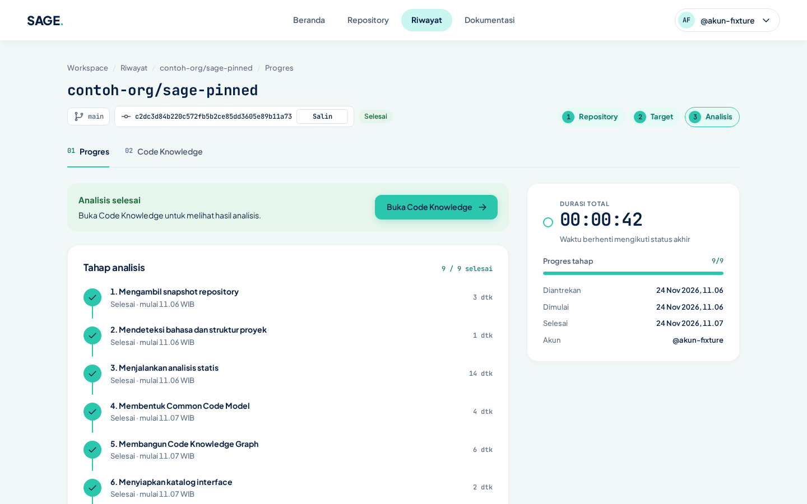
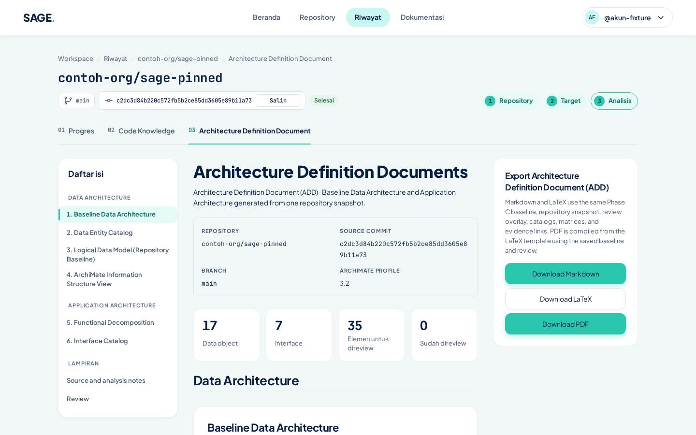
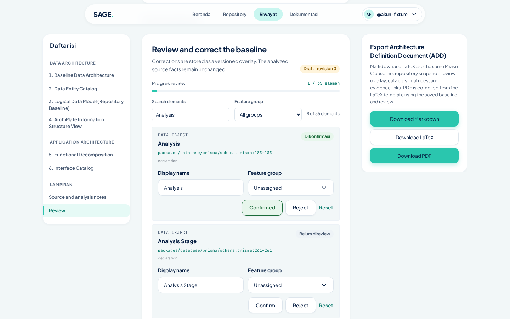
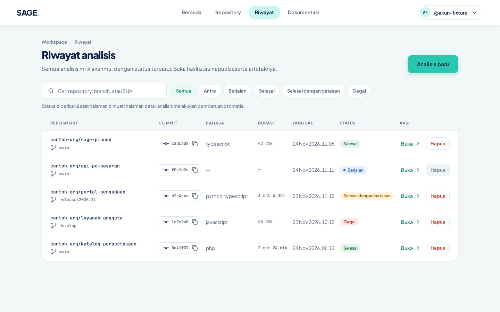

```mermaid
flowchart LR
  A["Login GitHub"] --> B["Pilih repo dan commit"] --> C["Analisis"] --> D["Code Knowledge"] --> E["Generate TOGAF ADD"] --> F["Review dan ekspor"]
  click A "https://github.com/AgilePemdigi-2026/sage/blob/main/docs/guides/GITHUB_APP_SETUP.md" "Setup GitHub App"
  click B "https://github.com/AgilePemdigi-2026/sage/blob/main/docs/guides/USAGE.md#pilih-target" "Pilih target"
  click C "https://github.com/AgilePemdigi-2026/sage/blob/main/docs/guides/USAGE.md#jalankan-analisis" "Progres dan error"
  click D "https://github.com/AgilePemdigi-2026/sage/blob/main/docs/guides/USAGE.md#baca-hasil" "Baca hasil"
  click E "https://github.com/AgilePemdigi-2026/sage/blob/main/docs/reference/TOGAF_ADD.md" "TOGAF ADD"
  click F "https://github.com/AgilePemdigi-2026/sage/blob/main/docs/guides/USAGE.md#ekspor-dan-history" "Review, ekspor, dan history"
```

<p align="center">
  
</p>

<p align="center">Ubah repository GitHub menjadi baseline TOGAF Phase C yang setiap klaimnya tertaut ke file, baris, dan commit.</p>

<p align="center">
  <a href="https://github.com/AgilePemdigi-2026/sage/actions/workflows/ci.yml"></a>
  <a href="https://sage.caiis.ai.id/"></a>
  
  
  
</p>

<p align="center"><a href="https://sage.caiis.ai.id/">Buka SAGE</a> · <a href="docs/guides/USAGE.md">Panduan</a> · <a href="docs/README.md">Dokumentasi</a> · <a href="CONTRIBUTING.md">Kontribusi</a></p>


## Dalam angka

Semua angka di bawah bisa dicek di repository ini.

| Angka | Artinya | Sumber |
| --- | --- | --- |
| **9** | Tahap pipeline analisis, dari snapshot sampai penyimpanan hasil | [`packages/contracts/src/stages.ts`](packages/contracts/src/stages.ts) |
| **10** | Bagian ADD Phase C: 5 Data Architecture dan 5 Application Architecture | [`packages/documents/src/phase-c-add.ts`](packages/documents/src/phase-c-add.ts) |
| **4** | Bahasa yang dibaca statis: JavaScript, TypeScript, PHP, dan subset Python. Ditambah kontrak SQL, OpenAPI, dan JSON Schema | [`docs/reference/ANALYSIS_SPEC.md`](docs/reference/ANALYSIS_SPEC.md#kriteria-capability) |
| **20** | Skenario BDD Sprint 1 (GitHub, repository, antrean, runner, source, UI) | [`tests/bdd/features/`](tests/bdd/features/) |
| **57** | Skenario BDD Sprint 2 lulus (220 langkah, 0 gagal) | [`docs/evidence/BDD-Sprint2-Gherkin-2026-11-09.json`](docs/evidence/BDD-Sprint2-Gherkin-2026-11-09.json) |
| **100 / 100** | Lighthouse landing, Performance dan Accessibility (mobile, 3 run). LCP 1,1 detik | [`docs/evidence/ui-revisi-2-lighthouse-2026-11-24.json`](docs/evidence/ui-revisi-2-lighthouse-2026-11-24.json) |

## Sebelum dan sesudah

Contoh: menyusun **Data Entity Catalog** untuk repository dengan 17 model Prisma.

**Sebelum (manual).** Buka `schema.prisma`. Cari setiap blok `model`. Salin namanya ke tabel. Catat file dan nomor barisnya sebagai bukti. Ulangi 17 kali. Ulangi lagi setiap ada commit baru.

**Sesudah (SAGE).** Pilih repository dan commit. SAGE menghasilkan katalog berikut, lengkap dengan evidence per baris:

| Data entity | Evidence |
| --- | --- |
| Analysis | [`schema.prisma:183`](tests/fixtures/semantic/sage-pinned/packages/database/prisma/schema.prisma#L183) |
| Analysis Stage | [`schema.prisma:261`](tests/fixtures/semantic/sage-pinned/packages/database/prisma/schema.prisma#L261) |
| Export | [`schema.prisma:362`](tests/fixtures/semantic/sage-pinned/packages/database/prisma/schema.prisma#L362) |
| Repository | [`schema.prisma:167`](tests/fixtures/semantic/sage-pinned/packages/database/prisma/schema.prisma#L167) |
| User | [`schema.prisma:84`](tests/fixtures/semantic/sage-pinned/packages/database/prisma/schema.prisma#L84) |

Potongan 5 dari 17 baris. Semua baris berasal dari blok `model` Prisma, jadi deskripsinya sama untuk setiap baris ("Data model explicitly declared by a Prisma model block."). Hasil asli pipeline analyzer, semantic model, dan ADD baseline atas fixture [`tests/fixtures/semantic/sage-pinned`](tests/fixtures/semantic/sage-pinned/) (snapshot source SAGE sendiri, commit `c2dc3d8`). Kolom Group dan Application access kosong pada fixture ini, jadi tidak ditampilkan juga.

## Cara kerja

Klik node untuk membuka panduan terkait. Pada layar kecil, buka diagram untuk memperbesar.



1. **Login GitHub.** Masuk lewat GitHub App. Token hanya disimpan di server.
2. **Pilih repo dan commit.** Pilih repository dan branch. SAGE mengunci analisis ke satu full SHA.
3. **Analisis.** Snapshot dibaca statis dalam 9 tahap. Kode target tidak pernah dijalankan.
4. **Code Knowledge.** Telusuri module, simbol, dan dependency sampai ke file dan baris sumbernya.
5. **Generate TOGAF ADD.** SAGE menyusun baseline Data dan Application Architecture dari snapshot yang sama.
6. **Review dan ekspor.** Konfirmasi atau koreksi elemen, lalu unduh Markdown, LaTeX, atau PDF.

## Fitur

| Fitur | Yang bisa dilakukan |
| --- | --- |
| Akses GitHub | Pilih repository public milikmu, public pihak lain, atau private yang diizinkan GitHub App |
| Analisis | Pilih branch dan commit, pantau 9 tahap beserta durasinya, lalu retry bila gagal |
| Code Knowledge | Cari, filter, dan fokus pada node. Inspector menunjukkan evidence file dan baris |
| TOGAF Phase C ADD | Baseline Data dan Application Architecture dari satu snapshot commit |
| Catalog dan matrix | Data entity, interface, functional decomposition, CRUD, dan interaksi aplikasi |
| Review dan ekspor | Koreksi nama dan kelompok sebagai overlay. Ekspor Markdown, LaTeX, atau PDF A4 |
| Riwayat | Cari, buka ulang, atau hapus analisis milikmu beserta artefaknya |

## Tampilan

Semua screenshot diambil dari aplikasi asli dengan akun dan nama repository sintetis. Rincian ada di [catatan screenshot](docs/assets/screenshots/README.md).

### Repository


### Progres



### TOGAF ADD



### Review ADD



### Code Knowledge


### Riwayat



## Quick start

Siapkan **Node.js 24** dan Docker Compose. Pengguna macOS bisa memakai [Colima](docs/guides/LOCAL_SETUP.md).

```sh
git clone https://github.com/AgilePemdigi-2026/sage.git
cd sage
node scripts/setup-local.mjs
node scripts/setup-github-app.mjs
docker compose up -d --build --wait --wait-timeout 180
```

Buka [localhost:3000](http://localhost:3000). Login butuh GitHub App milikmu sendiri: ikuti [panduan GitHub App](docs/guides/GITHUB_APP_SETUP.md). Jangan commit `.env`, token, atau private key. Langkah lengkap, cara berhenti tanpa kehilangan data, dan troubleshooting ada di [setup lokal](docs/guides/LOCAL_SETUP.md).

## Batasan

**Batas analyzer**

- JavaScript, TypeScript, dan PHP dibaca secara statis.
- Python baru subset konservatif: deklarasi, route literal gaya FastAPI, model gaya SQLAlchemy, dan relasi lokal.
- SQL, OpenAPI JSON/YAML, dan sebagian JSON Schema menyumbang kontrak data dan interface.
- Kode target tidak dijalankan. Bahasa dan framework lain belum didukung otomatis.
- LLM kampus hanya membantu narasi, dan hanya jika pengguna memberi consent. LLM tidak menambah fakta arsitektur.

**Code Knowledge dan ADD**

- Keduanya keluaran berbeda. Graph membantu menelusuri source. ADD adalah dokumen arsitektur utama.
- ADD saat ini hanya baseline.
- Target architecture, gap/RAG analysis, business capability mapping, owner, dan lokasi deployment tetap butuh input manusia.
- `Proven` dan `Indicated` tidak mengubah resolution CCM `Exact` atau `Unresolved`.
- Rincian: [panduan ADD](docs/reference/TOGAF_ADD.md) dan [kontrak analyzer](docs/reference/ANALYSIS_SPEC.md).

## Dokumentasi

| Kebutuhan | Panduan |
| --- | --- |
| Mulai memakai aplikasi | [Penggunaan](docs/guides/USAGE.md) · [Troubleshooting](docs/guides/TROUBLESHOOTING.md) |
| Menjalankan dan menguji | [Setup lokal](docs/guides/LOCAL_SETUP.md) · [Testing](docs/guides/TESTING.md) |
| Memahami hasil analisis | [Analyzer](docs/reference/ANALYSIS_SPEC.md) · [Semantik](docs/reference/SEMANTIC_ANALYSIS.md) · [Format keluaran](docs/reference/DOCUMENT_PRESENTATION.md) |
| Mengelola layanan | [Deployment, resource, backup, dan pemulihan](docs/operations/COOLIFY.md) |
| Meninjau requirement dan bukti | [Planning](docs/planning/README.md) · [Arsip pemeriksaan](docs/archive/README.md) · [Evidence](docs/evidence/) |

[Buka seluruh dokumentasi](docs/README.md).

## Tim

Kelompok 4 PPL, Sistem Informasi, Universitas Airlangga (UNAIR).

| Anggota | GitHub |
| --- | --- |
| Iltizam Muhammad Hasan | [@iltizamhasan3](https://github.com/iltizamhasan3) |
| Rizqy Fadhil Athallah | [@rizqy-fadhil](https://github.com/rizqy-fadhil) |
| Valentina Hermawan | [@liliks13](https://github.com/liliks13) |
| Zarra Firdaus Ananda Salia | [@zarrrafirdaus](https://github.com/zarrrafirdaus) |
