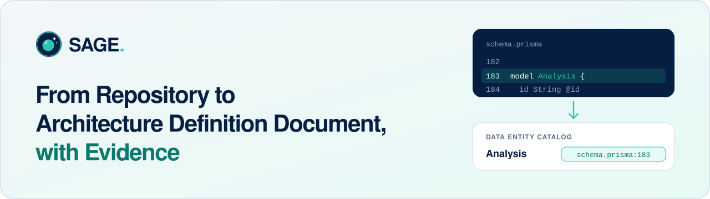
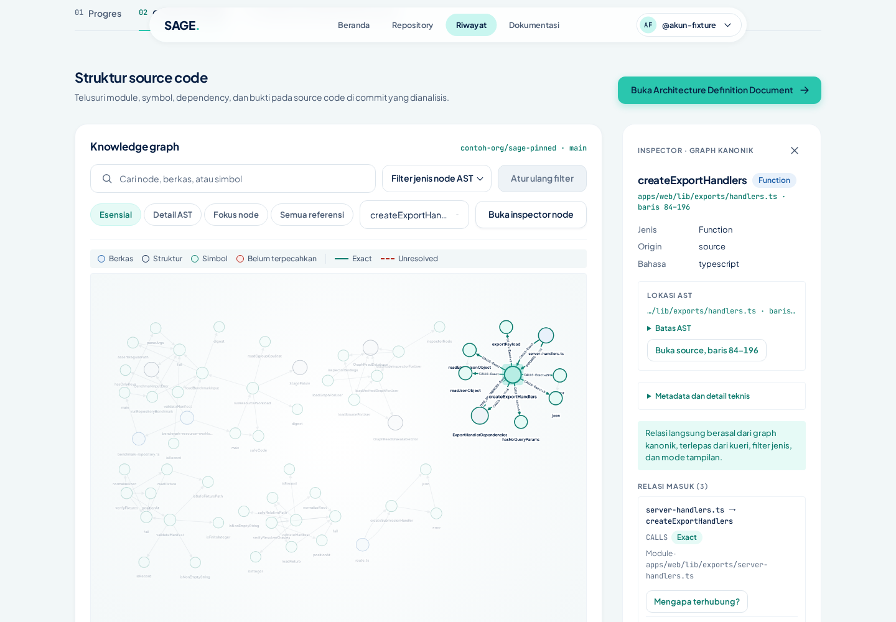
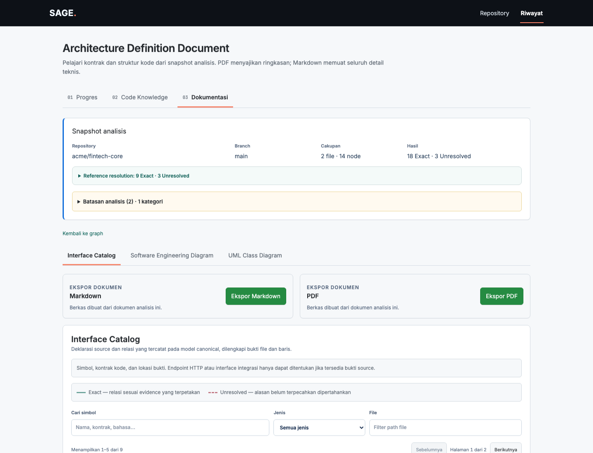

<p align="center">
  
</p>

<p align="center"><strong>Source-code Architecture Graph Extraction</strong><br />Analisis repository menjadi TOGAF Phase C baseline yang bisa ditelusuri kembali ke source.</p>

<p align="center"><a href="https://sage.caiis.ai.id/">Buka SAGE</a> · <a href="docs/guides/USAGE.md">Panduan penggunaan</a> · <a href="docs/PROJECT_OVERVIEW.md">Project overview untuk AI agent</a> · <a href="docs/README.md">Dokumentasi</a> · <a href="CONTRIBUTING.md">Kontribusi</a></p>

## Fitur dan dukungan

| Fitur | Yang bisa dilakukan |
| --- | --- |
| Akses GitHub | Login dengan GitHub App; pilih repository public sendiri, public pihak lain, atau private yang diizinkan |
| Analisis repository | Pilih branch/commit, jalankan pipeline berurutan, pantau progres dan elapsed time, lalu retry jika gagal |
| Code Knowledge | Visual pendamping untuk menelusuri struktur source, dependency, filter node, fokus tetangga, dan evidence file/baris |
| TOGAF Phase C ADD | Susun baseline Data Architecture dan Application Architecture dari satu snapshot commit |
| Catalog dan matrix | Baca data entity, interface, functional decomposition, CRUD, dan interaksi yang didukung evidence |
| Review dan ekspor | Koreksi nama/kelompok sebagai overlay; unduh Markdown, LaTeX, atau gunakan print-to-PDF A4 dari snapshot yang sama |
| History | Cari dan buka kembali hasil milik akun sendiri, lalu hapus analisis beserta artefaknya setelah konfirmasi |

**Batas analyzer:** JavaScript/TypeScript dan PHP dibaca secara statis. Python baru mendukung subset konservatif untuk deklarasi, route literal FastAPI-style, model SQLAlchemy-style, dan relasi lokal; SQL, OpenAPI JSON/YAML, serta sebagian JSON Schema menyumbang data/interface contract. Kode target tidak dijalankan dan bahasa/framework lain belum otomatis didukung. LLM kampus hanya membantu narasi jika pengguna memberi consent; ia tidak menambah fakta arsitektur.

**Code Knowledge dan ADD adalah keluaran berbeda.** Graph membantu menelusuri source; ADD adalah dokumen arsitektur utama. ADD saat ini hanya baseline: target architecture, gap/RAG analysis, business capability mapping, owner, dan lokasi deployment memerlukan input manusia. `Proven`/`Indicated` tidak mengubah resolution CCM `Exact`/`Unresolved`. Lihat [panduan ADD](docs/reference/TOGAF_ADD.md) dan [kontrak analyzer](docs/reference/ANALYSIS_SPEC.md).

## Tampilan aplikasi

Screenshot berasal dari aplikasi aktual dengan data fixture aman. Nama repository contoh dan commit sintetis bukan hasil analisis repository pengguna; cakupan pengambilannya tercatat pada [catatan screenshot](docs/assets/screenshots/README.md).

### Pemilihan repository


### Code Knowledge



### Dokumentasi hasil (tampilan sebelum revisi ADD)



## Workflow

Klik node untuk membuka panduan terkait. GitHub menyediakan kontrol diagram; pada layar kecil, buka diagram untuk memperbesar.

```mermaid
flowchart LR
  A["Login GitHub"] --> B["Pilih repo dan commit"] --> C["Analisis"] --> D["Code Knowledge"] --> E["Generate TOGAF ADD"] --> F["Review dan ekspor"]
  click A "https://github.com/AgilePemdigi-2026/sage/blob/main/docs/guides/GITHUB_APP_SETUP.md" "Setup GitHub App"
  click B "https://github.com/AgilePemdigi-2026/sage/blob/main/docs/guides/USAGE.md#pilih-target" "Pilih target"
  click C "https://github.com/AgilePemdigi-2026/sage/blob/main/docs/guides/USAGE.md#jalankan-analisis" "Progres dan error"
  click D "https://github.com/AgilePemdigi-2026/sage/blob/main/docs/guides/USAGE.md#baca-hasil" "Baca hasil"
  click E "https://github.com/AgilePemdigi-2026/sage/blob/main/docs/reference/TOGAF_ADD.md" "TOGAF ADD"
  click F "https://github.com/AgilePemdigi-2026/sage/blob/main/docs/guides/USAGE.md#ekspor-dan-history" "Review, ekspor, dan history"
```



## Tech stack

<p align="center">
  <a href="https://nextjs.org/"></a>
  <a href="https://react.dev/"></a>
  <a href="https://www.typescriptlang.org/"></a>
  <a href="https://tailwindcss.com/"></a>
  <a href="https://nodejs.org/"></a>
  <a href="https://www.php.net/"></a>
  <a href="https://www.postgresql.org/"></a>
  <a href="https://www.prisma.io/"></a>
  <a href="https://www.docker.com/"></a>
  <a href="https://playwright.dev/"></a>
</p>

<p align="center">Next.js · React · TypeScript · Tailwind CSS · Node.js<br />PHP · PostgreSQL · Prisma · Docker · Playwright</p>

Web/API memakai Next.js; worker Node.js mengorkestrasi analyzer statis JavaScript/TypeScript, PHP, dan subset Python serta proses ekspor. PostgreSQL menyimpan metadata dan hasil canonical. Snapshot serta file ekspor berada pada volume privat. LLM kampus bersifat opsional dan hanya menerima ringkasan nama/relasi setelah consent. Rincian ada di [arsitektur](docs/reference/ARCHITECTURE.md), [panduan ADD](docs/reference/TOGAF_ADD.md), dan [model data](docs/reference/DATA_MODEL.md). Logo mengikuti [lisensi aset](docs/assets/tech/README.md).

## Quick start Docker

Siapkan **Node.js 24** dan Docker dengan Compose yang aktif. Pengguna macOS dapat mengikuti [setup Colima](docs/guides/LOCAL_SETUP.md).

```sh
git clone https://github.com/AgilePemdigi-2026/sage.git
cd sage
node scripts/setup-local.mjs
docker compose config --quiet
docker compose build
docker compose up -d --wait --wait-timeout 180
```

Buka [localhost:3000](http://localhost:3000). `web`, `worker`, dan `db` harus healthy; `migrate` selesai dengan exit 0. **Login memerlukan konfigurasi GitHub App sendiri** sesuai [panduan GitHub App](docs/guides/GITHUB_APP_SETUP.md). Jangan commit `.env`, token, atau private key.

Untuk menghentikan aplikasi tanpa menghapus data, jalankan `docker compose stop`. Untuk menyalakan container yang sudah dibuat, jalankan `docker compose start`; gunakan `up` di atas jika container belum ada. Perubahan source memerlukan build dan `up` kembali. Jangan memakai `down -v` bila ingin mempertahankan data. Panduan lengkap tersedia pada [setup lokal](docs/guides/LOCAL_SETUP.md).

## Dokumentasi

| Kebutuhan | Panduan |
| --- | --- |
| Mulai memakai aplikasi | [Penggunaan](docs/guides/USAGE.md) · [Troubleshooting](docs/guides/TROUBLESHOOTING.md) |
| Menjalankan dan menguji | [Setup lokal](docs/guides/LOCAL_SETUP.md) · [Testing](docs/guides/TESTING.md) |
| Memahami hasil analisis | [Analyzer](docs/reference/ANALYSIS_SPEC.md) · [Semantik](docs/reference/SEMANTIC_ANALYSIS.md) · [Format keluaran](docs/reference/DOCUMENT_PRESENTATION.md) |
| Mengelola layanan | [Deployment, resource, backup, dan pemulihan](docs/operations/COOLIFY.md) |
| Meninjau requirement dan bukti | [Planning](docs/planning/README.md) · [Arsip pemeriksaan](docs/archive/README.md) · [Evidence](docs/evidence/) |

[Buka seluruh dokumentasi](docs/README.md).
