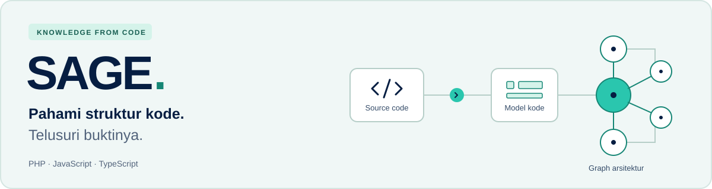

# 🌿 SAGE



**Source-code Architecture Graph Extraction for Evidence-Grounded Software Architecture Documentation.**

SAGE dikembangkan untuk membantu memahami arsitektur repository GitHub melalui **Code Knowledge Graph** dan dokumentasi yang dapat ditelusuri ke source code. Target analisis mencakup **PHP dan JavaScript/TypeScript**, dengan keluaran Markdown serta PDF.

📖 [Panduan lokal](docs/LOCAL_SETUP.md) · 🎯 [Product backlog](docs/PRODUCT_BACKLOG.md) · 🗓️ [Sprint plan](docs/SPRINT_PLAN.md) · 🤝 [Kontribusi](CONTRIBUTING.md)

> 🚧 **Dalam pengembangan — Sprint 1, per 19 Oktober 2026.**
> Fondasi Docker, model data/session/kredensial, isolasi pengguna, adapter deklarasi PHP/JS/TS, kontrak CCM/evidence, antrean durable, runner tahap, serta pratinjau UI/graph sudah tersedia. Login/logout GitHub App sudah terverifikasi dengan provider nyata; pengujian terisolasi juga mencakup error, replay, dan pencabutan sesi. Halaman akses repository sudah tersambung ke GitHub untuk public dan daftar instalasi; public dan private berizin sudah terverifikasi dengan provider nyata. Analisis repository lengkap, graph produk, history, dan ekspor masih mengikuti issue masing-masing. Ini belum seluruh MVP.

## 🎯 Kemampuan yang ditargetkan

| | Kemampuan | Hasil yang ingin dicapai |
| --- | --- | --- |
| 🔐 | Akses GitHub | Login, repository publik milik pihak lain, dan repository private yang telah diotorisasi |
| 🔎 | Analisis source code | Adapter PHP dan JS/TS dengan model kode serta kontrak evidence yang sama |
| 🕸️ | Code Knowledge Graph | Telusuri module, class, interface, function, dan hubungan antarkode |
| 📍 | Bukti yang dapat diperiksa | Temuan terhubung ke file, baris, dan snapshot commit yang dianalisis |
| 📝 | Dokumentasi arsitektur | Interface Catalog, Software Engineering Diagram, UML Class Diagram, serta Architecture Definition Document |
| 📦 | Ekspor dan riwayat | Simpan Markdown/PDF, buka kembali analisis, dan hapus data milik pengguna |

Seluruh kemampuan di atas masuk target MVP lokal. Status implementasi serta acceptance criteria mengikuti [backlog](docs/PRODUCT_BACKLOG.md) dan [test plan](docs/TEST_PLAN.md).

## 🚀 Menjalankan aplikasi di lokal

Gunakan **Docker Engine/Desktop dengan Compose** yang sudah aktif dan **Node.js 24** untuk script setup. PHP, PostgreSQL, runtime aplikasi, serta Chromium dijalankan di container; tidak perlu memasangnya satu per satu pada host.

### 1. Clone dan siapkan konfigurasi

```sh
git clone https://github.com/AgilePemdigi-2026/sage.git
cd sage
node scripts/setup-local.mjs
docker compose config --quiet
```

Sudah punya repository-nya? Masuk ke folder `sage` dan mulai dari command setup. Script membuat `.env` privat dengan password PostgreSQL dan key enkripsi acak. Jika `.env` sudah ada, nilai lama dipertahankan dan key yang belum tersedia ditambahkan. Tidak perlu menyalin placeholder `.env.example`.

### 2. Build lalu start aplikasi

```sh
docker compose build
docker compose up -d --wait --wait-timeout 180
docker compose ps
```

**Build menyiapkan image; `up` menjalankan aplikasinya.** Tunggu command `up` selesai. Service `web`, `worker`, dan `db` seharusnya berstatus **healthy**. Service `migrate` boleh berstatus **Exited (0)** karena tugas migrasinya sudah selesai.

### 3. Konfigurasikan login GitHub

Login nyata memerlukan GitHub App. Bootstrap menyiapkan form registrasi dan menyimpan kredensial langsung ke `.env` privat setelah konfirmasi pemilik akun:

```sh
node scripts/setup-github-app.mjs --name NAMA-APP-YANG-UNIK
docker compose up -d --force-recreate --no-deps web
```

Ikuti [panduan GitHub App](docs/GITHUB_APP_SETUP.md). Callback pengembangan menggunakan `http://localhost:3000/auth/github/callback`; gunakan port web 3000 untuk konfigurasi ini. Pembuatan/otorisasi App dan instalasi repository merupakan langkah berbeda. Tanpa konfigurasi App, halaman login menampilkan kondisi belum tersedia. Jangan mengirim client secret atau private key lewat chat maupun commit.

### 4. Buka aplikasi di browser

| Tujuan | Alamat |
| --- | --- |
| 🌿 Halaman aplikasi | **[http://localhost:3000](http://localhost:3000)** |
| 💚 Pemeriksaan layanan | [http://localhost:3000/api/health](http://localhost:3000/api/health) |

Halaman awal, login GitHub App, dan workspace dengan pemeriksaan sesi sudah tersedia; alur analisis repository menyusul sesuai backlog. Health check yang berhasil mengembalikan `status: "ok"` dan `database: "ok"`.

### 4. Stop, jalankan kembali, atau perbarui

```sh
# Menghentikan aplikasi; data pada volume tetap tersimpan.
docker compose stop

# Menjalankan kembali aplikasi yang sudah dibuild.
docker compose up -d --wait --wait-timeout 180
```

Setelah menarik perubahan kode terbaru:

```sh
git pull --ff-only
node scripts/setup-local.mjs
docker compose build
docker compose up -d --wait --wait-timeout 180
```

Untuk memeriksa kendala:

```sh
docker compose ps --all
docker compose logs --tail=100 web worker migrate
```

Jika port 3000 dipakai aplikasi lain, ubah `WEB_PORT=3001` di `.env`, jalankan kembali command `up`, lalu buka `http://localhost:3001`. Pada macOS dengan Colima, mulai VM dan pilih Docker context terlebih dahulu sesuai [panduan lokal](docs/LOCAL_SETUP.md#prasyarat-dan-menjalankan).

📘 Migrasi, smoke test, persistensi, dan troubleshooting lebih lengkap tersedia di [panduan setup lokal](docs/LOCAL_SETUP.md). Bukti implementasi: [DATA-01](docs/DATA-01_CHECKS.md), [kontrak CCM](docs/ANA-05-S1_CHECKS.md), serta [oracle minimum](docs/QA-01-S1_CHECKS.md).

## 🧰 Stack teknologi

<p>
  <a href="https://nextjs.org/"></a>
  <a href="https://react.dev/"></a>
  <a href="https://www.typescriptlang.org/"></a>
  <a href="https://tailwindcss.com/"></a>
  <a href="https://nodejs.org/"></a>
  <a href="https://www.php.net/"></a>
  <a href="https://www.postgresql.org/"></a>
  <a href="https://www.prisma.io/"></a>
  <a href="https://www.docker.com/"></a>
  <a href="https://playwright.dev/"></a>
</p>

| Area | Teknologi |
| --- | --- |
| 🖥️ Web dan API | Next.js App Router · React · TypeScript · Tailwind CSS |
| ⚙️ Pemrosesan | Worker Node.js terpisah dari proses web |
| 🗄️ Database | PostgreSQL · Prisma ORM |
| 🟨 Analyzer JavaScript/TypeScript | TypeScript Compiler API |
| 🐘 Analyzer PHP | nikic/PHP-Parser melalui runtime PHP pada worker |
| 🕸️ Graph interaktif | Cytoscape.js — direncanakan untuk integrasi graph |
| 📄 Dokumen dan PDF | Mermaid untuk rendering diagram · Playwright/Chromium untuk PDF |
| 🐳 Lingkungan lokal | Docker Compose · Persistent volumes |

Logo disimpan lokal; sumber dan lisensinya tersedia di [aset teknologi](docs/assets/tech/README.md). Dependency dipin pada lockfile dan base image memakai digest. Renderer SVG/PDF sudah melewati probe fondasi; generator artefak produk serta ekspor terotorisasi tetap perlu diimplementasikan dan diuji.

## 🧭 Prinsip pengembangan

- **Berbasis bukti:** fakta teknis berasal dari static analysis; resolusi relasi hanya `Exact` atau `Unresolved`.
- **Target konsisten:** repository, branch, dan full SHA dipertahankan sepanjang analisis; kode target dibaca sebagai data.
- **Alur bertahap:** satu analisis repository aktif secara global, dengan sembilan tahap pipeline berurutan.
- **Akses sesuai pemilik:** login diperlukan untuk analisis, history, hasil, dan penghapusan; akses private mengikuti izin GitHub.
- **Retensi jelas:** hasil disimpan sampai pemilik menghapusnya; kredensial tetap mengikuti masa berlaku dan pencabutan akses.
- **UI Indonesia:** pendekatan mobile first dengan pengalaman desktop yang lengkap.
- **Lokal lebih dahulu:** MVP diterima melalui Docker; deployment dan anggaran produksi menunggu keputusan dosen.
- **MVP sebelum eksperimen:** seluruh fitur wajib ditargetkan selesai Sprint 2; LLM opsional setelah MVP freeze.

## 📚 Dokumentasi proyek

| Dokumen | Kegunaan |
| --- | --- |
| 🎯 [PRD](docs/PRD.md) | Tujuan, cakupan, pengguna, dan batas MVP |
| 🧾 [Requirement traceability](docs/REQUIREMENTS_TRACEABILITY.md) | Pemetaan 72 requirement SRS ke backlog dan pengujian |
| 🏗️ [Arsitektur](docs/ARCHITECTURE.md) | Komponen aplikasi, stack, pipeline, dan lingkungan lokal |
| 🔬 [Spesifikasi analisis](docs/ANALYSIS_SPEC.md) | CCM, node, edge, evidence, cakupan analyzer, dan artefak |
| 🗄️ [Model data](docs/DATA_MODEL.md) | Entitas penyimpanan, lifecycle, dan penghapusan |
| 🔌 [Kontrak API](docs/API_CONTRACT.md) | Endpoint, payload, otorisasi, status, dan error |
| 🎨 [Design guidelines](docs/DESIGN_GUIDELINES.md) | Acuan Figma, token, bahasa UI, state, dan responsivitas |
| 📋 [Product backlog](docs/PRODUCT_BACKLOG.md) | 39 issue, dependensi, acceptance criteria, dan penanggung jawab |
| 🗓️ [Sprint plan](docs/SPRINT_PLAN.md) | Kalender pengerjaan/review dan target tiap sprint |
| ⚖️ [Alokasi sprint](docs/SPRINT_ALLOCATION.md) | Deliverable tiap anggota dan bukti kontribusi |
| ✅ [Definition of Done](docs/DEFINITION_OF_DONE.md) | Syarat deliverable dan MVP dinyatakan selesai |
| 🧪 [Test plan](docs/TEST_PLAN.md) | Fixture, integrasi GitHub, dan verifikasi ekspor |
| 🧭 [Keputusan dan risiko](docs/DECISIONS.md) | Keputusan, rancangan awal, TBD, dan risiko |
| 📎 [Sumber](docs/SOURCES.md) | PDF, Figma, referensi teknis, dan urutan acuan |
| 🤝 [Kontribusi](CONTRIBUTING.md) | Pembagian modul, issue, branch, PR, commit, dan alur merge |

Mulai dari PRD, keputusan, dan spesifikasi analisis, kemudian backlog serta sprint plan. Kontrak API dan model data diperbarui bersama ketika implementasi mengubah kontrak.

## 🗓️ Roadmap sprint

Semua tanggal mengikuti **Asia/Jakarta**. Setiap siklus terdiri atas dua minggu pengerjaan dan satu minggu review user story.

| Sprint | Fokus | Pengerjaan | Review |
| --- | --- | --- | --- |
| 🌱 Sprint 1 | Fondasi, akses repository, kontrak, dan jalur dasar dua bahasa | 12–25 Oktober 2026 | 26 Oktober–1 November 2026 |
| 🛠️ Sprint 2 | Integrasi seluruh alur MVP dan feature freeze | 2–15 November 2026 | 16–22 November 2026 |
| ✨ Sprint 3 | Regression, penyempurnaan, dokumentasi, dan demo | 23 November–6 Desember 2026 | 7–13 Desember 2026 |

**Target feature-complete: 15 November 2026.** Kalender merupakan rencana; status selesai tetap memerlukan bukti dan review sesuai Definition of Done.

## 🤝 Tim dan kontribusi

| Anggota | GitHub | Fokus modul |
| --- | --- | --- |
| Iltizam Muhammad Hasan | [@iltizamhasan3](https://github.com/iltizamhasan3) | Kontrak/JS/TS, canonical CKG, login/snapshot, review teknis, dan merge |
| Rizqy Fadhil Athallah | [@rizqy-fadhil](https://github.com/rizqy-fadhil) | Akses/target repository, queue/pipeline, history, dan pengujian integrasi |
| Valentina Hermawan | [@liliks13](https://github.com/liliks13) | UI, graph/inspector, diagram, PDF, dan verifikasi visual |
| Zarra Firdaus Ananda Salia | [@zarrrafirdaus](https://github.com/zarrrafirdaus) | Model data, oracle, analyzer PHP, catalog/ADD, Markdown, dan cleanup |

Pekerjaan dilacak melalui issue, branch, PR, dan bukti verifikasi. Gunakan **Conventional Commit satu baris/satu kalimat**. Penanggung jawab serta hasil aktual mengikuti [alur kontribusi](CONTRIBUTING.md) dan [alokasi sprint](docs/SPRINT_ALLOCATION.md).

## 📌 Langkah berikutnya

1. Akses instalasi/private dan public pihak lain tersedia melalui **GH-02 #6**; pemilihan branch/commit tersedia melalui **REP-01 #7**, tanpa membuat job analisis.
2. Lanjutkan snapshot, resolver lintas file, dan canonical CKG di atas adapter deklarasi yang sudah tersedia.
3. Hubungkan runner tahap ke pipeline nyata dan UI sesuai dependensi pada backlog.
4. Terima setiap issue setelah scope, bukti pengujian, review, dan merge terpenuhi.
